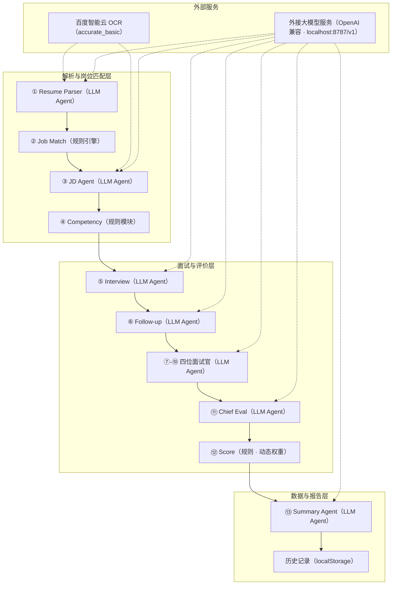
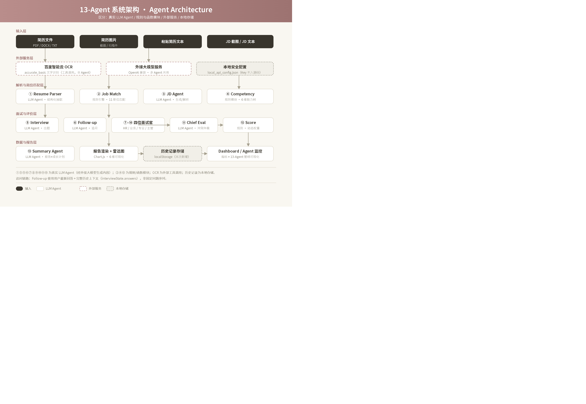
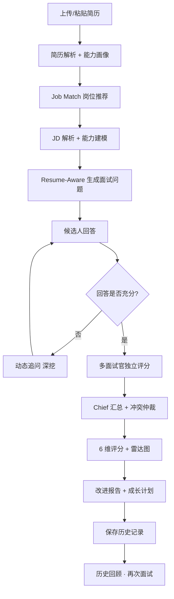
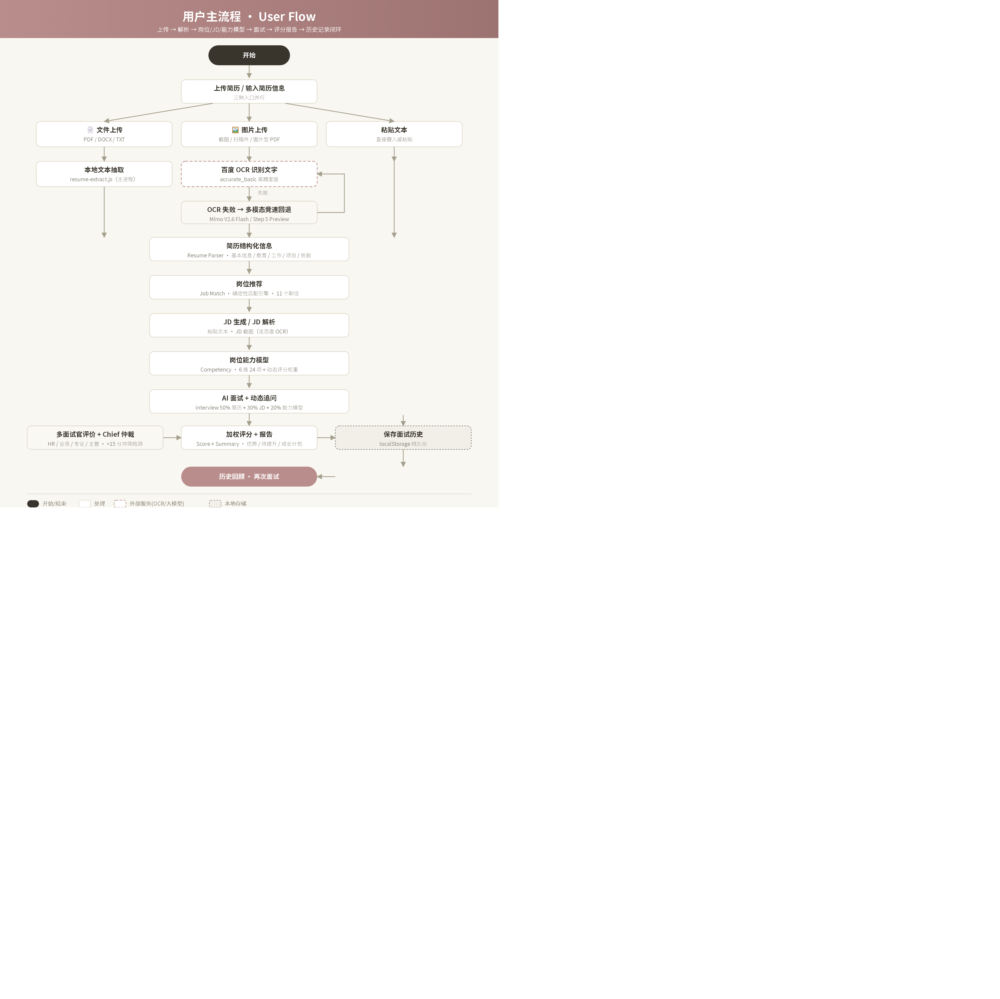

# AI Career Copilot · Resume-Aware Career Interview Agent

> 基于 **Multi-Agent 架构**的 AI 求职与面试陪练系统：上传简历 → 岗位匹配 → JD 解析 → 能力建模 → Resume-Aware 模拟面试 → **5 位虚拟面试官独立评分** → 多维报告与成长建议 → **本机历史记录回溯**。
>
> 项目包含**三个可独立运行的版本**，分别面向"秒懂产品"、"真实工程"与"桌面分发"三种场景（详见 [第 1.2 节](#12-三个版本分别是什么)）。
>
> **适合岗位**：AI 产品经理 / AI 应用开发（实习）

---

## 🚀 30 秒看懂

| 你想看什么 | 怎么看 |
|-----------|--------|
| **完整产品交互（推荐先打开）** | 直接用浏览器打开根目录 `index.html`，无需安装、无需 Key |
| **桌面版（当前主力版本）** | Electron 便携 EXE：接入**外接大模型 API**（出题/追问/评分/报告真实生成）、**百度智能云 OCR**（简历图片 / JD 截图文字识别）、**面试历史记录**（localStorage 持久化）。源码在本仓库 `electron-app/` 目录，构建产物 `AI-Career-Copilot-20261015d.exe` |
| **真实大模型工程实现** | 进入 `python-backend/`，配置 Key 后 `streamlit run streamlit_app.py`（见 [12.3](#123-运行真实大模型后端python-streamlit)） |
| **核心流程图（多张短图）** | `docs/flows/`：用户主流程 / API 调用 / OCR 子流程 / 历史记录 / 13-Agent 架构（SVG 源 + PNG） |
| **产品与架构文档** | 见 `docs/PRD.md`、`docs/competency_framework.md` 与 `docs/flows/agent_architecture.png` |

---

## 目录

- [1. 项目背景与版本](#1-项目背景与版本)
- [2. 产品目标](#2-产品目标)
- [3. 核心功能（已实现）](#3-核心功能已实现)
- [4. Multi-Agent 架构](#4-multi-agent-架构)
- [5. 评分体系](#5-评分体系)
- [6. 产品流程与流程图](#6-产品流程与流程图)
- [7. 技术栈](#7-技术栈)
- [8. 桌面版新增能力（2026-10 迭代）](#8-桌面版新增能力2026-10-迭代)
- [9. 项目亮点](#9-项目亮点)
- [10. 项目角色与难点](#10-项目角色与难点)
- [11. 测试方法与真实结果](#11-测试方法与真实结果)
- [12. 快速开始](#12-快速开始)
- [13. 已知限制（诚实清单）](#13-已知限制诚实清单)
- [14. 目录结构](#14-目录结构)
- [15. 安全说明](#15-安全说明)
- [16. 更新日志](#16-更新日志)

---

## 1. 项目背景与版本

### 1.1 背景

传统求职准备存在结构性低效：

- **岗位匹配靠肉眼**：候选人难以判断自己与目标岗位的契合度，准备方向发散。
- **面试准备缺乏针对性**：通用面试题库与本人经历脱节，"背题"难以迁移到真实追问。
- **面试评价单一**：自评或单次反馈缺乏结构化维度，不知道"差在哪、怎么补"。
- **缺乏持续成长反馈**：一次面试结束即终止，没有"评估 → 改进 → 再评估"的闭环。

大语言模型与 Agent 技术的成熟，使"低成本、个性化、可溯源"的 AI 陪练成为可能。

### 1.2 三个版本分别是什么

| 版本 | 位置 | 技术栈 | 定位 |
|---|---|---|---|
| **桌面版（当前主力）** | 本仓库 `electron-app/` | HTML/CSS/JS 单文件 + Electron 28 便携打包 + 百度智能云 OCR | 真实可分发产品：外接大模型真实生成面试内容、OCR 识别图片简历/JD、历史记录本机持久化 |
| **Web Demo** | 本仓库根目录 `index.html` | 纯 HTML/CSS/JS 单文件（Chart.js 本地化） | 免 Key 秒开的高保真交互原型，完整呈现产品设计与交互 |
| **工程后端** | `python-backend/` | Python 3.10+ · Streamlit · OpenAI 兼容 SDK · Cline 本地 API | 真实调用大模型的服务端实现（多轮面试闭环） |

> 三个版本**不混写技术栈**：桌面版 ≠ Web Demo ≠ Python 后端，各自独立运行。

---

## 2. 产品目标

帮助用户完成闭环：

> **找到适合的岗位 → 针对简历与 JD 准备 → 进行真实模拟面试 → 获得多维评价 → 明确能力差距 → 拿到成长计划 → 历史回溯追踪能力变化**

---

## 3. 核心功能（已实现）

### 3.1 桌面版（Electron，当前主力）

| 功能 | 说明 | 状态 |
|------|------|------|
| 简历三入口解析 | 📄 文件（PDF/DOCX/TXT，主进程本地抽取）· 🖼️ 图片（百度 OCR 优先，多模态回退）· ⌨️ 粘贴文本 | ✅ 已实现 |
| 岗位推荐 | 确定性匹配引擎（`job-matching.js`），11 个职位，含匹配分/原因/技能/缺口/路径 | ✅ 已实现 |
| JD 双模式 | 自动生成 / 粘贴解析；JD 截图走百度 OCR 高精度版；粘贴文本渲染 PNG 再走 OCR 提关键词 | ✅ 已实现 |
| 能力建模 | 按岗位类型 6 维能力树 + 动态评分权重 | ✅ 已实现 |
| Resume-Aware 面试 | 5 位面试官 × 6 维，三行格式评分（评分/评价/追问），问题 = 50% 简历 + 30% JD + 20% 能力模型 | ✅ 已实现 |
| 动态追问 | 基于 `interviewState.answers` 真实回答递进，上限 2 轮 | ✅ 已实现 |
| Chief 仲裁 | 面试官分差 >15 分自动冲突检测 | ✅ 已实现 |
| 评分报告 | 加权总分 + verdict + Top3 优势/待提升 + 雷达图 + 30/60/90 天计划 | ✅ 已实现 |
| **面试历史记录** | localStorage 持久化（`acc_history_v1`）：列表/详情还原/删除确认/空态/损坏隔离 | ✅ 本次迭代新增 |
| **外接大模型 API** | 设置页配置 Key/模型/BaseURL，主进程代理 fetch，5 模型可选 + 智能切换 | ✅ 本次迭代新增 |
| **百度智能云 OCR** | `accurate_basic` 高精度版：简历图片 + JD 截图 | ✅ 本次迭代新增 |
| Dashboard / Agent 监控 | 8 指标 + 面试官分布 + 评分热力图 + 13-Agent 管线 | ✅ 已实现 |

### 3.2 Web Demo（免 Key 原型）

以下能力均在本仓库根目录 `index.html` 中可交互：简历解析、岗位推荐（11 个）、JD 解析、能力建模、Resume-Aware 面试、动态追问、5 面试官独立评分、6 维动态权重、面试报告、Dashboard。

> **诚实说明**：Web Demo 的 Agent 协作与评分采用**脚本化/规则模拟**，用于完整呈现产品设计与交互流程；桌面版与 `python-backend/` 为真实大模型调用。

---

## 4. Multi-Agent 架构

桌面版包含 **13 个模块**，覆盖从简历输入到录用决策的完整链路。**严格区分**：真实 LLM Agent / 规则函数模块 / 外部服务 / 本地存储——不把普通模块包装成 Agent。





| 模块 | 类型 | 职责 |
|------|------|------|
| Resume Parser | LLM Agent | 简历结构化抽取（图片先经 OCR） |
| Job Match | 规则引擎 | 11 职位确定性匹配 |
| JD Agent | LLM Agent | 生成 / 解析 JD，抽取硬技能·软技能·业务要求 |
| Competency | 规则模块 | 按岗位类型生成能力树，确定评分维度 |
| Interview | LLM Agent | 50% 简历 + 30% JD + 20% 能力模型混合问题生成 |
| Follow-up | LLM Agent | 动态追问（使用最新回答 + 完整上下文） |
| HR / Business / Professional / Leader | LLM Agent | 四位角色独立评分 |
| Chief Evaluation | LLM Agent | 汇总评分、仲裁冲突（>15 分）、最终决策 |
| Score | 规则模块 | 6 维度动态权重评分 |
| Summary | LLM Agent | 个性化报告 + 成长计划 |
| 百度 OCR | 外部服务 | 图片文字识别（工具调用，非 Agent） |
| 历史记录 | 本地存储 | localStorage 持久化 |

---

## 5. 评分体系

采用 **6 维度、动态权重、evidence-based** 评分。不同岗位类型使用不同维度权重（桌面版可切换产品/AI/技术/数据/运营等类型）。

| 维度 | 评估重点 |
|------|----------|
| 沟通能力（comm） | 表达清晰度、逻辑连贯、观点传达 |
| 业务理解（biz） | 商业敏感度、业务拆解、ROI 意识 |
| 专业深度（tech） | 岗位硬技能、技术/方法论掌握 |
| 领导力（leader） | Owner 意识、决策、抗压与团队带动 |
| 策略思维（strategy） | 抽象建模、系统性、长期视角 |
| 文化匹配（culture） | 价值观、协作意识、岗位契合 |

**多面试官交叉评分**是缓解"单一 AI 评分偏差"的核心机制：四位面试官各自独立打分，Chief Evaluation 汇总并标注分歧。录用结论与置信度为**模型启发式估计**，非真实招聘数据验证结果。

---

## 6. 产品流程与流程图





### 6.1 流程图集（多张短图，SVG 源 + PNG）

| 图 | 用途 | 源文件 |
|---|---|---|
| 用户主流程 | 三入口分支（文件不走 OCR / 图片走 OCR / 粘贴文本）→ 面试 → 历史闭环 | `docs/flows/user_flow.svg` |
| 外接大模型 API 调用流程 | 请求组装 → 配置读取 → IPC 代理 → 外接模型 → 解析校验 → 状态更新 → 历史保存 | `docs/flows/api_call_flow.svg` |
| 百度 OCR 子流程 | 格式校验 → accurate_basic → 清洗 → 回填模块；失败/重试/空结果处理 | `docs/flows/ocr_flow.svg` |
| 历史记录流程 | 组装记录 → localStorage → 列表/详情/删除确认/兼容策略 | `docs/flows/history_flow.svg` |
| 13-Agent 架构 | 输入层 → 解析匹配层 → 面试评价层 → 数据报告层 + 外部服务 | `docs/flows/agent_architecture.svg` |

> 旧版单张超长流程图保留在 `docs/logic_flow.svg` / `docs/logic_flow.html`（含判定分支与异常回退）。
> 流程图由 `docs/flows/gen_flows.py` 生成（可维护源），PNG 由 `electron-app/tools/svg2png.js` 导出。

---

## 7. 技术栈

| 类别 | 技术 |
|------|------|
| **桌面版（当前主力）** | HTML/CSS/JS 单文件（`electron-app/index.html`）· Electron 28 便携打包 · Node 主进程 IPC（ai-chat 代理 / baidu-ocr / parse-resume-file）· Chart.js 4.4.1 · localStorage |
| **外接大模型** | OpenAI 兼容 `/chat/completions`（默认 `http://localhost:8787/v1`，`cline-free/mimo-v2.6-flash`），主进程代理 fetch，90s 超时，429/502 指数退避 |
| **OCR** | 百度智能云文字识别（高精度版 `accurate_basic`），OAuth2.0 token 缓存 |
| **Web Demo** | 纯 HTML/CSS/JS 单文件 · Chart.js · Web Speech API |
| **工程后端（`python-backend/`）** | Python 3.10+ · Streamlit · OpenAI 兼容 SDK · pypdf / python-docx · Plotly / Pandas |
| **工程方法** | Multi-Agent 模块化设计、Prompt Engineering、Git、产品文档驱动开发 |

---

## 8. 桌面版新增能力（2026-10 迭代）

### 8.1 外接大模型 API

- **接入方式**：密钥与 Base URL 默认从本地安全配置 `local_api_config.json` 读取（`extraResources` 打包在 asar 之外，**不硬编码、不入 Git**）；用户可在「设置」页覆盖并保存至 localStorage。
- **调用链路**：前端组装 messages（系统 Prompt + 用户输入 + 历史问答上下文）→ IPC `ai-chat` → 主进程代理 fetch → 外接模型 → 解析 `choices[0].message.content` → 校验与异常处理 → 更新面试状态 → 面试结束保存历史。
- **动态追问**使用用户**刚提交的最新回答**与完整历史上下文，非固定问题序列。
- **异常处理**：网络失败 / 401 / 404 / 429 / 502 / 空内容均有明确提示；**任何日志与页面不泄露 Key**。
- 模型选项：Mimo V2.6 Flash（默认）/ Step 5 Preview / Solar Mini 4 / Muse Spark 1.3（上游区域限制 502）/ 智能切换。

### 8.2 百度智能云 OCR

- **应用场景（仅两处）**：① 简历图片（截图/扫描件）文字识别；② JD 截图识别 + 关键词块。**PDF/DOCX/TXT 不走 OCR**（本地文本抽取）。
- **流程**：格式/大小校验 → 压缩 → base64 → IPC `baidu-ocr` → `accurate_basic` → 有效性检查（<5 字符视为空）→ 文本清洗 → 回填解析模块 → 用户确认/修改/重新识别。
- **失败处理**：未配置 / 网络异常 / 权限错误 / 空结果 → 明确提示；简历图片失败自动回退多模态竞速识别；JD 图片失败提示改用粘贴文本；**不破坏原有文本输入流程**。
- **已弃用**：百度 NLP 关键词接口因权限受限（error 6）弃用；JD 关键词改由「粘贴文本渲染 PNG → OCR 高精度版」实现。

### 8.3 面试历史记录

- **存储位置**：渲染进程 `localStorage`（键 `acc_history_v1`），Electron 便携版随用户目录持久化；**关闭并重新打开应用后数据仍在**。
- **数据结构**：见 [`docs/history-data-spec.md`](docs/history-data-spec.md)（字段说明 + 数据示例 + 兼容策略）。
- **能力**：列表（时间/岗位/难度/状态/总分）· 统计（次数/平均/最高/最近）· 详情还原（问答/追问/评分/报告）· 删除二次确认 · 空状态 · 加载失败重试 · 损坏数据隔离（转移至 `acc_history_v1_corrupt`）· 旧记录缺字段兼容展示。
- **边界**：单用户本机应用，**不支持多账号隔离与云端同步**；保存失败（如存储配额耗尽）明确提示，不静默丢失。

---

## 9. 项目亮点

1. **Resume-Aware Interview**：问题强制引用简历具体经历，个性化而非通用题库。
2. **多面试官独立评分**：四角色交叉打分 + Chief 仲裁，规避单一视角偏差。
3. **JD-Aware + 岗位库结合**：问题同时融合简历、JD 与能力模型三方信号。
4. **动态权重评分**：评分维度权重随岗位类型变化，更贴近真实招聘标准。
5. **完整产品闭环**：简历 → 岗位推荐 → JD 解析 → 能力建模 → 模拟面试 → 报告 → 历史回溯 → 再次面试。
6. **真实能力接入**：外接大模型（真实生成）+ 百度 OCR（真实识别）+ 本机持久化（真实保存），非纯演示。
7. **安全与隐私优先**：API Key 仅本地配置、简历仅以文本送入模型、历史记录不上传。
8. **测试可信**：自动化测试 + 真实 API 调用测试 + 模拟数据测试分层报告，不虚构数据（见第 11 节）。

---

## 10. 项目角色与难点

**AI 产品经理 / AI 应用开发**

本人负责：产品定位与用户流程设计、Multi-Agent 架构设计（13 模块编排）、评分体系与能力模型设计、Prompt 工程与交互设计、桌面版前端与 Electron 工程实现、PRD 与文档撰写、测试与 GitHub 整理。

**核心难点**：

- **让 AI 真正理解简历**：结构化 Schema 约束解析，图片入口先经 OCR 再抽取。
- **根据简历 + JD 生成针对性问题**：强制 `resume_ref` + `jd_ref` + `competency` 三方信号。
- **实现动态追问**：依据回答深度逐层递进，把敷衍回答转化为有效评估信号。
- **避免单一 AI 评分偏差**：多面试官交叉评分 + Chief 冲突仲裁。
- **密钥安全**：主进程代理 + 本地配置文件 + asar 之外，兼顾可用与安全。

---

## 11. 测试方法与真实结果

桌面版测试位于 `electron-app/tests/`，分三类（**不虚构数据**）：

| 类型 | 测试 | 结果（2026-10-19 实测） |
|---|---|---|
| 自动化（纯逻辑） | `job_matching.test.js` | 69/0 通过 |
| 自动化（Electron DOM） | `dom_smoke.js` / `flow_check.js` / `radar_reload_check.js` / `step4_type_check.js` / `jd_analyze_check.js` | 通过 |
| 自动化（Electron DOM） | `history_check.js`（本次新增，27 断言） | 27/0 通过 |
| 真实 API 调用 | `api_regression.js` / `ocr_regression.js` / `baidu.test.js` | 通过（限流时自动重试） |
| 已知失败项 | 无（round4 粘贴 JD 硬技能提取失败已修复：恢复「🔧 硬技能要求」独立分区，22/22 全过） | **全部通过** |

历史记录模块验证点：保存-加载往返 / 防重复保存 / 新记录不覆盖旧记录 / 损坏数据隔离 / 删除确认 / 旧记录兼容详情 / XSS 转义 / 路由无异常。

---

## 12. 快速开始

### 12.1 体验 Web Demo（无需安装）

浏览器打开本仓库根目录 `index.html`。

### 12.2 运行桌面版（Electron）

```bash
cd electron-app
npm install
# 配置本地密钥（gitignored，打包时经 extraResources 落在 asar 之外）
cp local_api_config.example.json local_api_config.json
# 编辑 local_api_config.json 填入 api_key / base_url / model / baidu.apiKey / baidu.secretKey
npm start
```

构建便携 EXE：

```bash
npm run dist-portable   # 产物：release/AI-Career-Copilot.exe
```

### 12.3 运行真实大模型后端（Python/Streamlit）

```bash
curl http://localhost:8787/health          # 确认本地 API 服务在跑
cd python-backend
pip install -r requirements.txt
mkdir -p .streamlit
echo 'LLM_API_KEY = "你的密钥"' > .streamlit/secrets.toml
python test_api_connectivity.py            # 6 项连通性检查
streamlit run streamlit_app.py
```

---

## 13. 已知限制（诚实清单）

1. **百度 NLP 关键词接口**：权限受限（error 6），已弃用，JD 关键词走 OCR 替代实现。
2. **Muse Spark 1.3 模型**：上游返回 502（地区限制），属服务端问题。
3. **历史记录**：仅本机 localStorage，无云端同步与多账号隔离；存储配额耗尽时保存失败并提示。
4. **DOC 旧格式**：不支持，需转存 DOCX/PDF。
5. **评分与录用结论**：模型启发式估计，非真实招聘数据验证结果。

---

## 14. 目录结构

```
resume-aware-interview-agent/
├── index.html                 # Web Demo（免 Key 秒开，13 Agent + 5 面试官）
├── chart.umd.min.js           # Demo 依赖（本地 Chart.js）
├── README.md
├── .gitignore
├── .env.example               # 环境变量模板（仅占位符）
│
├── python-backend/            # 真实大模型后端工程（Streamlit + Cline 本地 API）
│   ├── streamlit_app.py       # 主应用（多轮面试 / 追问 / 四面试官 / Chief / 报告）
│   ├── app.py                 # 原有 FastAPI 版（保留）
│   ├── config.py              # 模型配置 + Prompt 模板（无密钥）
│   ├── test_api_connectivity.py
│   ├── test_e2e_pipeline.py
│   ├── .streamlit/secrets.toml    # 本地密钥（gitignore）
│   ├── agents/ utils/ prompts/
│   ├── requirements.txt, .env.example
│   └── README.md
│
├── electron-app/             # 🖥️ 桌面版源码（Electron，当前主力版本）
│   ├── index.html            # 单文件应用（UI + 面试引擎 + 历史记录模块）
│   ├── main.js               # 主进程：ai-chat 代理 / baidu-ocr / parse-resume-file IPC
│   ├── preload.js            # 安全 IPC 桥
│   ├── baidu.js              # 百度 OCR 封装（token 缓存）
│   ├── job-matching.js       # 确定性岗位匹配引擎
│   ├── resume-extract.js     # PDF/DOCX/TXT 本地文本抽取
│   ├── package.json          # electron + electron-builder 配置
│   ├── local_api_config.example.json  # 密钥模板（仅占位符；真实文件 gitignored）
│   ├── tests/                # 测试套件（job_matching / history_check / dom_smoke 等）
│   └── tools/svg2png.js      # 流程图 SVG → PNG 导出工具
│
├── docs/                      # 产品与架构文档
│   ├── PRD.md
│   ├── competency_framework.md
│   ├── history-data-spec.md   # 历史记录数据结构与兼容策略（本次新增）
│   ├── flows/                 # 流程图集（本次新增）
│   │   ├── gen_flows.py       # SVG 生成源
│   │   ├── user_flow.svg/.png
│   │   ├── api_call_flow.svg/.png
│   │   ├── ocr_flow.svg/.png
│   │   ├── history_flow.svg/.png
│   │   └── agent_architecture.svg/.png
│   ├── agent_architecture.png     # 旧版架构图（保留）
│   ├── user_flow.png / system_architecture.png
│   ├── logic_flow.svg / logic_flow.html   # 旧版超长流程图（保留）
│
├── screenshots/               # 应用界面截图
├── uploads/                   # 运行时上传目录（不入库）
└── logs/                      # 运行时日志目录（不入库）
```

> 桌面版源码位于本仓库 `electron-app/`（`index.html` + `main.js` + `baidu.js` + `job-matching.js` + `tests/`），便携 EXE 分发名 `AI-Career-Copilot-20261015d.exe`（二进制不入库，见 `.gitignore`）。

---

## 15. 安全说明

- **绝不**将真实 API Key、百度密钥、`.env`、`local_api_config.json`、个人简历原文上传至仓库（已被 `.gitignore` 忽略）。
- 提供 `local_api_config.example.json` / `.env.example` 模板，**只含占位符**。
- 上传的简历仅在会话内以文本形式送入大模型，不做云端持久化；历史记录仅存本机 localStorage。
- 流程图、截图、README 与测试报告中**不出现任何真实密钥**。
- 演示如需简历样例，请使用**虚拟简历**，禁止包含真实姓名 / 手机号 / 邮箱密码 / 身份证等信息。

---

## 16. 更新日志

见 [`CHANGELOG.md`](CHANGELOG.md)。最近一次迭代（2026-10-19）：接入外接大模型 API 与百度 OCR 到桌面版产品流程；新增面试历史记录（localStorage 持久化）；更新 5 张流程图与 13-Agent 架构图；更新低保真原型（新增 API/OCR 状态页与历史记录中心）；补充测试与已知限制清单。

---

<p align="center">
  <sub>AI Career Copilot · Resume-Aware Career Interview Agent</sub>
</p>
